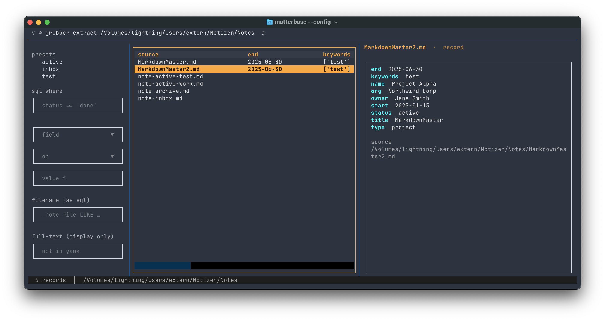

# matterbase

A database-like table view on frontmatter and YAML records in Markdown notes. Build a query command for the shell (field filters and SQL). For macOS and Linux.

## Why?

Markdown notes with frontmatter and YAML blocks can replace a dedicated
database for many personal records. Querying them usually means writing a
script or learning the syntax of a specialised tool.

matterbase puts a TUI in front of that. A query is built from preset filters,
a SQL WHERE clause and a filename search, and the matching records appear at
once in one table, whatever file they came from. `y` copies the underlying
shell pipeline, which can then be piped into other tools.

A typical workflow is to activate the `contacts` preset, add
`birthday IS NOT NULL` via the SQL form, and yank. The copied command pipes grubber through DuckDB.
Appending `| jq -r '.[] | .name + " " + .birthday'` turns it into a plain
list.

```
┌─ grubber … | duckdb 'SQL'  (y to copy) ──────────────────────────────┐
├────────────────┬────────────────────────────┬────────────────────────┤
│ query builder  │ the filtered records       │ adaptive preview       │
│  presets       │ (all sources, one table,   │ whole / compact /      │
│  sql where     │  source as a column)       │ record — global mode,  │
│  filename      │                            │ applied per type       │
│  full-text     │                            │                        │
└────────────────┴────────────────────────────┴────────────────────────┘
```


*The query builder on the left, every passing record in one table, and the
preview in `record` mode showing the selected record's fields.*

The unit is the **record**. A Markdown file contributes one record per YAML
block (plus the frontmatter), a JSONL file one record per line. The source
file is a field on the record (`_note_file`). The right pane previews the
source file, and `Enter` opens it in the editor to change the records or the
text around them. [ARCHITECTURE.md](ARCHITECTURE.md) describes the technical
layers.

matterbase is written in Go on
[Bubble Tea](https://github.com/charmbracelet/bubbletea) and ships as a single
static binary. It uses [grubber](https://github.com/rhsev/grubber) for record
extraction and filtering, [apex](https://github.com/ttscoff/apex) for preview
rendering, [bat](https://github.com/sharkdp/bat) for syntax highlighting, and
the [DuckDB](https://duckdb.org) CLI for SQL.

## Requirements

- [grubber](https://github.com/rhsev/grubber) **≥ 0.19.0**, on `PATH` or
  named in `$GRUBBER`. matterbase checks the version at startup. It scans the
  notes dir once per refresh into a JSONL cache and filters by replaying the
  cache through `grubber --from-jsonl`.
- [duckdb](https://duckdb.org) CLI for the SQL WHERE clause and the filename
  search, which runs as SQL. The UI runs the same `duckdb` command the yank
  produces. Without it, presets and full-text still work.
- [apex](https://github.com/ttscoff/apex) (optional, for preview rendering)
- [bat](https://github.com/sharkdp/bat) (optional, for syntax-highlighted
  preview of typst and other text files)

## Installation

```
go install github.com/rhsev/matterbase/cmd/matterbase@latest
```

Binaries for macOS arm64/amd64 and Linux amd64/arm64 are on the
[releases](https://github.com/rhsev/matterbase/releases) page. After download,
`chmod +x` the file and put it on `PATH`. macOS quarantines browser downloads,
which `xattr -d com.apple.quarantine matterbase-*` lifts.

## Usage

```
matterbase --config path/to/config.yml [PATH]
```

`PATH` replaces `notes_dir` from the config for this session, and
`--depth N` replaces `depth`. Both also hold after a config reload (`R`).

## Config

```yaml
notes_dir: ~/Notes/Work        # directory of record sources
editor: hx                     # editor command
apex_theme: nord256            # apex theme name (optional)
apex_width: 80                 # apex --width value (optional)
apex_code_highlight: pygments  # apex --code-highlight tool (optional)
apex_code_highlight_theme: nord  # its theme (optional)
grubber_search_mode: all       # all | frontmatter | blocks_only  (default: all)
grubber_mmd: false             # also parse MultiMarkdown metadata headers (optional)
depth: 2                       # limit directory recursion depth, 0 = no subdirectories (optional)
array_fields: [tags, keywords] # fields grubber normalises to arrays
table_columns: [status, project, type]    # column selection + order (omit = auto)
column_widths: {source: 30, status: 12}   # per-column widths (optional)
sql: "status != 'archive'"     # default SQL WHERE clause (optional)
grubber_set: notes             # yank via grubber config set (optional, see Yank)

presets:                       # the grubber query sets ("filters" also accepted)
  - label: "active"
    query:
      - "status=active"

  - label: "business"
    query:
      - "project=business"
      - "status=active"       # AND within one preset

  - label: "Q1-2026"
    query:
      - "start^2026-01"
```

### Filter operators (grubber syntax)

| Operator | Meaning      | Example          |
|----------|--------------|------------------|
| `=`      | equals       | `status=active`  |
| `~`      | contains     | `name~hosting`   |
| `^`      | starts with  | `end^2026`       |
| `!`      | not equals   | `status!archive` |

Multiple expressions within one preset are combined with AND. Several active
presets are combined with AND as well. All expressions go into a single
grubber call, so the yanked command returns exactly the records in the table.

## Keybindings

| Key                 | Action                                                  |
|---------------------|---------------------------------------------------------|
| `Tab`               | Cycle focus through builder, table                      |
| `↑` / `↓`           | Navigate records (or presets)                           |
| `Enter`             | Open the selected record's source file in the editor    |
| `Space`             | Toggle focused preset                                   |
| `/`                 | Jump to the SQL input                                   |
| `f`                 | Jump to the filename input                              |
| `t`                 | Jump to the full-text input                             |
| `-`                 | Remove the last AND clause from the SQL input           |
| `c`                 | Pick the table columns                                  |
| `m`                 | Cycle preview mode: whole → compact → record            |
| `p`                 | Toggle preview pane                                     |
| `J` / `K`           | Scroll the preview one line down / up                   |
| `Ctrl+F` / `Ctrl+B` | Scroll the preview one page down / up                   |
| `r`                 | Refresh data (re-scan the notes dir)                    |
| `R`                 | Reload the config (columns, presets; the query stays)   |
| `y`                 | Copy the constructed pipeline to the clipboard          |
| `Y`                 | Copy the pipeline to the clipboard and quit             |
| `Escape`            | Back to the record table                                |
| `q`                 | Quit                                                    |

## The query builder

The left pane holds three channels, all visible at once.

**Presets** are the predefined grubber queries from the config. `Space`
toggles them, and active presets combine with AND at record level.

**SQL WHERE** is a DuckDB clause over the extracted records (see
[SQL-QUERIES.md](SQL-QUERIES.md)). The **form** below it (field, operator,
value) writes a clause into the SQL input. Its fields come from the current
result set. `Enter` in the value field appends the clause with AND, and `-`
removes the last clause again. The SQL input stays freely editable.

The **filename search** runs as SQL. Typing `report` adds
`_note_file LIKE '%report%'` to the effective WHERE clause and to the yank.

**Full-text** narrows the *display* only and is never part of the yanked
command, because grubber and DuckDB cannot search the text of a note. It
searches the prose and YAML block text of Markdown and typst sources. JSONL
records have no body and drop out while full-text is active.

## The record table

The table shows every passing record across all sources, with the source
file as a column. `table_columns` sets the columns and their order. Without
it, matterbase picks the columns that fit the terminal by fill rate. `c` opens
a column picker that changes the selection for the session. The `record`
preview mode always shows every field of the selected record. `Enter` opens
the record's source in the editor.

## Adaptive preview (`m`)

One global mode applies to whichever record is selected, adapted to its
source type.

1. **whole** shows the full file, rendered via apex (Markdown) or bat (typst).
2. **compact** shows the frontmatter and the record's YAML block with its
   surrounding Markdown section.
3. **record** shows the record's fields as a form.

JSONL records always show the field form, since there is no body to render.

## Yank (`y` / `Y`)

`y` copies the constructed pipeline. It contains the structured query only and
matches the top bar:

```
grubber extract ~/Notes -a --from-jsonl ~/Notes/collections/ --explode binder --merge-on id,binder -f status=active | duckdb -json -c "SELECT * FROM read_json_auto('/dev/stdin') WHERE amount > 1000"
```

`Y` copies the command and quits.

With `grubber_set: NAME` in the config, the yank shrinks to
`grubber extract --set NAME …`. The set in grubber's config then holds the
database definition. For a fileregister collection it needs `path`,
`from_jsonl`, `explode: binder` and `merge_on: [id, binder]`. Without
`explode`, the yank returns one record per file with `binder` as an array,
while the table shows one record per binder. The short form only runs on
machines whose grubber config defines the set. matterbase does not check that
the set matches `notes_dir`.

matterbase calls grubber without `--no-config`. grubber's
`~/.config/grubber/config.yaml` and the `GRUBBER_*` variables therefore apply
to the table and to the yanked command alike. The search mode, `depth` and
`array_fields` from the matterbase config go to grubber as flags and take
precedence over grubber's config.

The clipboard tool is `pbcopy` on macOS, `wl-copy` on Wayland, and `xclip` or
`xsel` on X11.

## Collections

matterbase detects the central collection index of
[fileregister](https://github.com/rhsev/fileregister)
(`<notes_dir>/collections/*.jsonl`) and adds its records to the scan. An
annotated record appears **once**. `--explode binder` splits each index record
into one row per binder, and `--merge-on id,binder` merges each row with its
Markdown annotation, which keeps its own fields and gains the index fields.
Index records without an annotation appear under their JSONL source with the
field-form preview.

matterbase only queries and browses collections. Adding, promoting, auditing
and the rest of the collection lifecycle live in fileregister's `register`
CLI.

## This repo: the -base family

matterbase is built on **basekit** (`basekit/`), a small Bubble Tea
foundation in this repo with the theme, record table, layout frame and
inputs.

## License

MIT

---

*Part of a family of plain-text tools — the [profile page](https://github.com/rhsev) has the map.*
